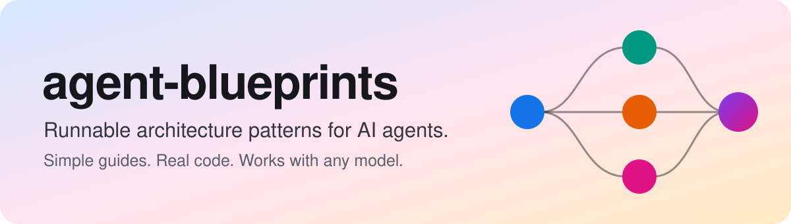
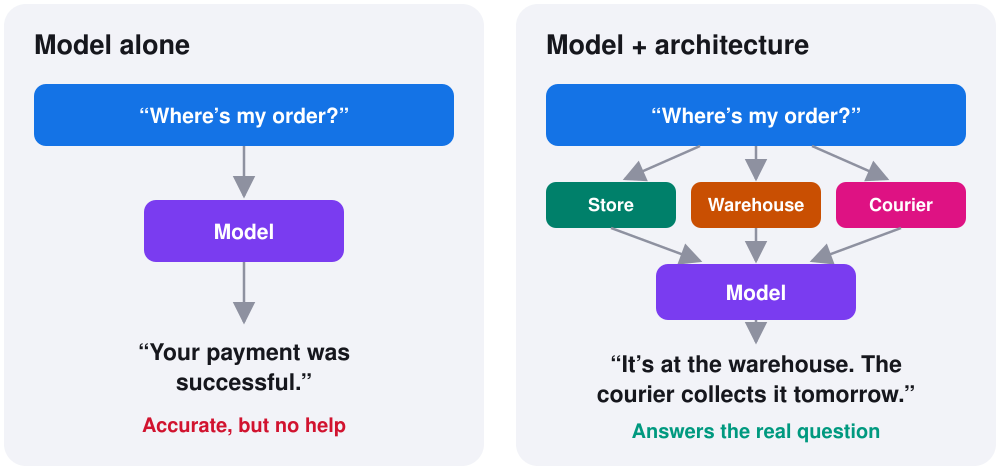
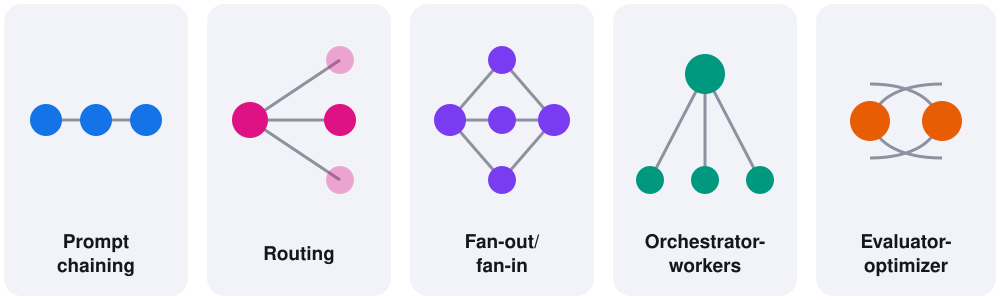

# agent-blueprints



Runnable architecture patterns for AI agents, explained in plain language.

Each blueprint gives you a simple guide, a picture, and real code you can run in about a minute. The code is built to work with Claude, GPT, Gemini, or a free local model.

Where it helps, a blueprint shows both a **workflow**, where your code decides the steps, and an **agent**, where the model decides. Start with the workflow, and use an agent when you can't know the steps in advance.

## Why architecture matters

Most AI applications don't fail because the model is weak. They fail because of the system around it.

A model can only work with what it receives. In a real product, the information it needs sits in different databases, APIs and documents. A customer asks "Where's my order?", and a model on its own can only answer from the small part it can see.



The model is the same in both pictures. The difference is the architecture: how the request moves, what data the model can reach, and how the steps work together.

Your architecture decides:

| | What it decides |
|---|---|
| **Accuracy** | Does the model see the right information? |
| **Speed** | Which steps can run at the same time? |
| **Cost** | How many model calls does each request make? |
| **Reliability** | What happens when one step fails? |
| **Trust** | Does the system admit what it couldn't confirm? |

Understanding this also changes how you fix problems. If the right data never reached the model, a better model or a longer prompt won't help.

## What is an architecture pattern?

A pattern is a proven way to structure an AI application. It's like a blueprint for a building: you don't design every house from scratch, and you don't need to design every agent from scratch either.

Once you know the patterns, you can recognize the shape of a problem and reuse a design that already works.



## The blueprints

| Pattern | In one line | Status |
|---|---|---|
| [Fan-out/fan-in](patterns/fan-out-fan-in/) | Ask several helpers at once, then combine their answers | Ready: workflow and agent |
| [ReAct](patterns/react/) | Think, act, look, repeat - until the agent knows enough | Ready: workflow and agent |
| Prompt chaining | Break a task into steps, where each step uses the last result | Planned |
| Routing | Send each request to the right specialist | Planned |
| Orchestrator-workers | Let a lead agent plan the work and hand it out | Planned |
| [Evaluator-optimizer](patterns/evaluatoroptimizer/) | Let one agent write and another check, until it's good | Ready: workflow and agent |

## Quick start

You need Python 3.10 or later, but no API key:

```bash
git clone https://github.com/rilov/agent-blueprints.git
cd agent-blueprints/patterns/fan-out-fan-in
pip install -r requirements.txt
python example.py
```

To use an AI model, install your provider's package and set one value:

```bash
pip install langchain-openai
export OPENAI_API_KEY=your-key
export MODEL=openai:gpt-5
python example.py
```

See the [fan-out/fan-in guide](patterns/fan-out-fan-in/) for Claude, Gemini and free local models.

## How each blueprint is organized

Every pattern gets its own folder, and each folder runs on its own:

```text
patterns/
└── fan-out-fan-in/
    ├── README.md          The simple guide
    ├── example.py         The smallest working version
    ├── agent.py           The agent version, where the model decides
    ├── try_it.py          The same idea on real data
    ├── try_it.ipynb       Notebook version
    ├── requirements.txt   What to install
    └── assets/            Pictures for the guide
```

Each guide follows the same order: the problem, the idea, the code, when to use it, and common mistakes.

## License

The code is available under the [MIT License](LICENSE). Datasets used by the examples have their own licences, which each guide lists.
