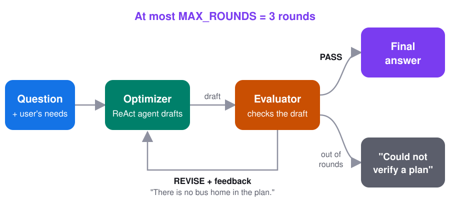
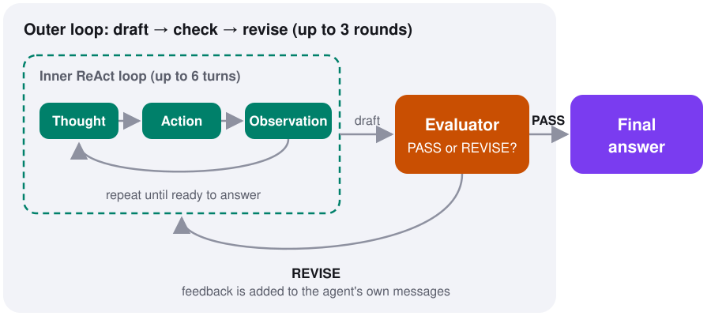
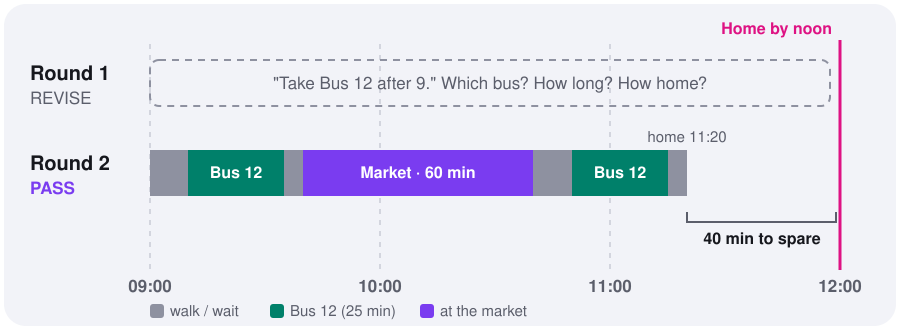
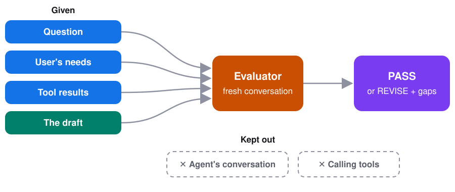

# Evaluator-Optimizer

**Let one agent write an answer and another check it, until it's good.**

[← All blueprints](../../README.md) · Builds on [ReAct](../react/)

**On this page**

- [What is evaluator-optimizer?](#what-is-evaluator-optimizer)
- [The problem](#the-problem)
- [The idea](#the-idea)
- [What's new compared to ReAct](#whats-new-compared-to-react)
- [Try it in one minute](#try-it-in-one-minute)
- [Try it with a real AI model](#try-it-with-a-real-ai-model)
- [The code, step by step](#the-code-step-by-step)
- [When to use it, and when not to](#when-to-use-it-and-when-not-to)
- [Common mistakes](#common-mistakes)

## What is evaluator-optimizer?

Evaluator-optimizer is a workflow with two roles in a loop:

- The **optimizer** writes an answer. Here, that's the ReAct agent you already know.
- The **evaluator** checks the answer against clear criteria and returns feedback.

If the evaluator finds gaps, the feedback goes back to the optimizer, which fixes them and tries again. The loop stops when the evaluator says PASS, or when you run out of rounds.

It's how people work, too. A writer drafts, an editor reviews, the writer revises. Anthropic describes it in [Building Effective Agents](https://www.anthropic.com/engineering/building-effective-agents). Nothing is retrained: the feedback only improves this one answer.

## The problem

The ReAct example ends with this answer:

> "Your bike has a flat tire. The rain stops at 9 AM, so take Bus 12 after 9."

It sounds right. But is the whole morning actually possible? Say the user also needs:

- an hour at the market,
- to leave only after the rain stops,
- to be home **before** noon.

"Bus 12 runs every 15 minutes" doesn't say which bus to catch. Nobody checked the walks to and from the stops. Nobody checked there is a bus home in time. The agent stopped as soon as it *felt* done, because nothing told it otherwise.

Finding Bus 12 is not enough. Someone has to check the whole plan.

## The idea



1. The ReAct agent answers, exactly as before.
2. The evaluator compares the answer with the user's needs and returns **PASS** or **REVISE** with specific feedback, like "there is no bus home in the plan."
3. On REVISE, the feedback goes back to the same agent. It calls the tools it skipped and writes a better answer.
4. Repeat, at most three rounds.

## What's new compared to ReAct

The ReAct code is copied almost unchanged. Only these parts are new:

| | ReAct | Evaluator-optimizer |
|---|---|---|
| Tools | weather, calendar, bike, bus | the same four, plus exact **bus times** and **walking times** |
| User's needs | none | 60 minutes at the market, leave after the rain, home before 12:00 |
| After the answer | done | an **evaluator** checks it |
| If something is missing | nobody notices | **feedback** goes back to the agent, which revises |
| Loops | one: Thought → Action → Observation | two: the ReAct loop inside a draft → check → revise loop |



The user's needs are demo settings, not part of the original question. A real assistant would ask for them, or state them as assumptions.

## Try it in one minute

No API key needed. A rule-based thinker plays the agent and a rule-based evaluator plays the reviewer:

```bash
pip install -r requirements.txt
python example.py
```

```
=== Round 1: the ReAct agent ===

Thought 1:     First I need to know if it will even be nice enough to bike.
Action 1:      check_weather('tomorrow morning')
...
Thought 5:     I have what I need. Time to write the answer.

Draft answer:
    Your bike has a flat tire. The rain stops at 9 AM, so take Bus 12 after 9.

=== Evaluator: REVISE ===
    - 'Every 15 minutes' is not a timetable. Which bus do you catch?
    - There is no way home. Can you be back before noon?
    - The walk home to bus stop is not counted.
    ...

=== Round 2: the ReAct agent ===

Thought 6:     The reviewer said: 'Every 15 minutes' is not a timetable. ... Let me check.
Action 6:      check_bus_times('to market')
Observation 6: Bus 12 to the market departs 09:10, 09:25, 09:40, 09:55, 10:10. Ride: 25 minutes.
...

Draft answer:
    Your bike has a flat tire, so take Bus 12:
    09:00-09:10  Walk to the bus stop
    09:10-09:35  Bus 12 to the market
    09:35-09:40  Walk to the market
    09:40-10:40  Shop at the market
    10:40-10:45  Walk to the bus stop
    10:45-10:50  Wait for the bus
    10:50-11:15  Bus 12 home
    11:15-11:20  Walk home

=== Evaluator: PASS ===

Answer: The draft above is verified. The bike is out, but Bus 12 works:
60 minutes at the market, home at 11:20, 40 minutes before noon.
```

Round 1 is the ReAct example's answer. The evaluator is what turns it from "sounds right" into "checked."



## Try it with a real AI model

`agent.py` is the same loop, but a model writes the drafts and a **separate** model call evaluates them:

```bash
MODEL=openai:gpt-4.1 python agent.py
```

Each provider needs its partner package (`langchain-openai`, `langchain-anthropic`, ...) and your key exported (`OPENAI_API_KEY`, ...).

Real models don't follow the script. The agent may call tools in a different order, or pick a different bus. That's fine: the evaluator checks the plan, not the route the agent took to it.

Smaller models struggle with time arithmetic. With `gpt-4o-mini`, the agent wrote "09:10 plus 25 minutes is 09:25," the evaluator kept saying REVISE, and after three rounds the run ended with "I could not verify a plan." That's the loop working. It refuses to pass a wrong plan, even if it can't fix it.

## The code, step by step

### The tools

```python
@tool
def check_bus_times(direction: str) -> str:
    """Exact Bus 12 departure times. direction is 'to market' or 'home'."""
    if direction == "to market":
        return "Bus 12 to the market departs 09:10, 09:25, 09:40, 09:55, 10:10. Ride: 25 minutes."
    return "Bus 12 home departs 10:35, 10:50, 11:05, 11:20, 11:35. Ride: 25 minutes."
```

As in ReAct, these are not real tools. They return hardcoded strings so you can learn the pattern without APIs. The first four tools are unchanged. The two new ones, `check_bus_times` and `check_walking_time`, give the details the first draft never asked for.

### The ReAct loop, unchanged

```python
def react(model, messages: list) -> str:
    for turn in range(1, MAX_TURNS + 1):
        response = model.invoke(messages)          # Thought
        ...
        result = TOOLS[call["name"]].invoke(...)   # Action
        messages.append(ToolMessage(...))          # Observation
```

This is the `run_agent` loop from the ReAct example. Two small changes: it takes the conversation as an argument, so a later round can continue it, and it saves every tool result in `observations` so the evaluator can see them.

### The evaluator, new

```python
def evaluate(model, question: str, answer: str) -> dict:
    review = model.invoke([
        SystemMessage(EVALUATOR_INSTRUCTIONS),
        HumanMessage(f"Question: ... User's needs: ... Tool results: ... Plan to check: ..."),
    ])
    ...
    return {"verdict": "PASS" or "REVISE", "feedback": [...]}
```

The evaluator is a separate model call with its own instructions and a **fresh conversation**. It sees the question, the needs, the tool results and the draft. It does not see the agent's conversation, and it cannot call tools. Its only job is to say PASS or REVISE, and, if REVISE, exactly what is missing.



Keeping it separate matters. An agent asked "are you sure?" in its own conversation tends to agree with itself. A fresh reviewer with a checklist does not.

If the reply isn't valid JSON, it counts as REVISE. An unreadable review never passes a plan.

### The outer loop, new

```python
for round_number in range(1, MAX_ROUNDS + 1):
    answer = react(model, messages)              # Optimizer: write a draft
    review = evaluate(base, question, answer)    # Evaluator: check it
    if review["verdict"] == "PASS":
        return answer
    messages.append(HumanMessage(                 # Feedback back to the agent
        "A reviewer checked your answer and found these gaps: ..."))

return "I could not verify a plan in time. ..."
```

This loop is the whole pattern. The agent drafts. The evaluator checks. The feedback is added to the **agent's** conversation, so in the next round the agent sees its old answer and what was wrong with it, and calls the tools it needs.

`MAX_ROUNDS = 3` keeps the loop finite. When it runs out, the agent says so. It never presents an unchecked draft as verified.

### The offline version

`example.py` follows the same steps without a model:

- `think()` is the ReAct thinker, plus one new rule: if the evaluator asked for something, call the tool that gets it.
- `evaluate()` checks the facts: are both bus timetables known, and all four walks? If so, it builds the trip and checks the real numbers: home before 12:00, at least 60 minutes at the market.
- `plan_trip()` does the time arithmetic in code, so it is always right.

That last point is worth copying into real systems: check numbers like times and totals in code, and leave the model to judge what code can't, like whether the answer actually addresses the question.

## When to use it, and when not to

**Use evaluator-optimizer when**

- you can write down what a good answer looks like ("home before noon," "every time comes from a timetable"),
- a first draft is often almost right, and specific feedback would fix it,
- a wrong answer is costly enough to be worth a second look.

**Don't use it when**

- there are no clear criteria. An evaluator with vague instructions just adds cost,
- the first answer is usually right already,
- latency matters. Each round adds at least two model calls.

## Common mistakes

- **No round limit.** Write `MAX_ROUNDS` first, and say honestly when it runs out.
- **Vague feedback.** "Make it better" doesn't help. "There is no bus home in the plan" does.
- **Letting the agent grade itself.** Use a separate call with its own instructions and context.
- **Trusting the evaluator with arithmetic.** Models can wrongly pass a late plan. Check numbers in code when you can.
- **Changing the needs to make a plan pass.** If no plan fits, say so. Don't quietly drop the 60 minutes.
