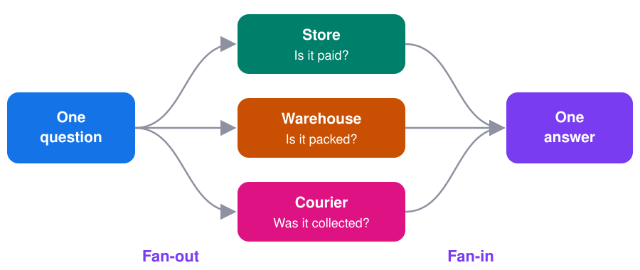
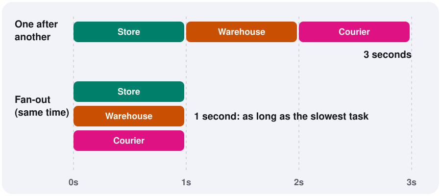
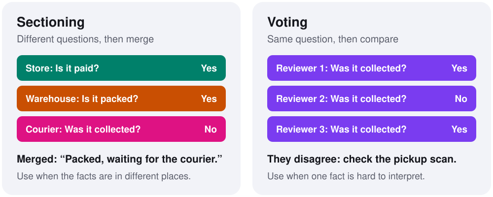

# Fan-Out/Fan-In

**Split one job into tasks that run at the same time, then combine their results into one answer.**

[← All blueprints](../../README.md)

**On this page**

- [The problem](#the-problem)
- [The idea](#the-idea)
- [Why it's faster](#why-its-faster)
- [The three parts](#the-three-parts)
- [Try it in one minute](#try-it-in-one-minute)
- [The code, step by step](#the-code-step-by-step)
- [Use any AI model](#use-any-ai-model)
- [Two ways to use it](#two-ways-to-use-it)
- [When you don't know the number of tasks](#when-you-dont-know-the-number-of-tasks)
- [What happens when a task fails](#what-happens-when-a-task-fails)
- [How to design the fan-in](#how-to-design-the-fan-in)
- [Try it on real data](#try-it-on-real-data)
- [When to use it, and when not to](#when-to-use-it-and-when-not-to)
- [Common mistakes](#common-mistakes)

## The problem

A customer asks your AI assistant:

> "I paid three days ago. It was supposed to arrive today. Where's my order?"

Suppose the assistant can only see the payment system. It replies:

> "Your payment was successful."

That's true, but it doesn't answer the question. The full answer is split across three systems:

| System | What it knows |
|---|---|
| **Store** | The order is confirmed and paid |
| **Warehouse** | The parcel was packed yesterday |
| **Courier** | Today's pickup was missed, and it will try again tomorrow |

No single system can answer the customer. The assistant has to collect all three facts and put them together:

> "Your package is still at the warehouse. The courier missed today's pickup and will collect it tomorrow."

This kind of problem comes up constantly in AI applications. The answer is in several places, or the work can be split into several pieces. Fan-out/fan-in is the standard way to handle it.

## The idea



The name describes the shape:

1. **Fan-out:** one request spreads out into several tasks, like the ribs of an open fan.
2. **Fan-in:** the results come back together into one response.

Think of planning a dinner. You could visit the butcher, the baker and the grocer yourself, one at a time. Or you could ask three friends to go at once, wait for them to return, and then cook with everything they bring. Sending the friends is the fan-out. Cooking with the results is the fan-in.

## Why it's faster



Most of the time in an AI application is spent waiting: for an API, a database or a model to respond. While one task waits, another can run. So when tasks run at the same time, the total wait is close to the time taken by the **slowest task**, and not the sum of all of them.

| Task times | One after another | Fan-out |
|---|---|---|
| 1s, 1s, 1s | 3s | 1s |
| 0.2s, 0.3s, 0.5s | 1s | 0.5s |
| 0.2s, 0.3s, 10s | 10.5s | 10s |

The last row shows the catch. Fan-in waits for every task, so one slow task sets the pace for the whole request. That's why every task needs a timeout, which is covered [below](#what-happens-when-a-task-fails).

Fan-out helps when tasks spend their time waiting. It won't speed up heavy calculations on your own machine in the same way.

## The three parts

Every fan-out/fan-in system has the same three parts:

| Part | Its job | In our example |
|---|---|---|
| **Splitter** | Decides which tasks to run | Ask the store, warehouse and courier |
| **Workers** | Do one task each, without depending on each other | One lookup per system |
| **Aggregator** | Combines the results into one output | A model writes the customer's reply |

The key word is **independent**. Each worker must be able to finish without another worker's result. That's what allows them to run at the same time.

## Try it in one minute

You need Python 3.10 or later, but no API key.

```bash
git clone https://github.com/rilov/agent-blueprints.git
cd agent-blueprints/patterns/fan-out-fan-in
pip install -r requirements.txt
python example.py
```

You'll see this:

```text
     store: The order is confirmed and paid.
 warehouse: The parcel was packed yesterday.
   courier: We missed today's pickup. We will collect it tomorrow.

All three answered in 1.0 seconds, not 3.
```

Each pretend system waits one second. All three finish in one second because they run at the same time.

## The code, step by step

This walks through [example.py](example.py), which is the smallest working version.

### Step 1: Create the workers

Each worker is an ordinary function that knows one thing. Here, `asyncio.sleep(1)` stands in for a real API call.

```python
async def ask_store(order_id):
    await asyncio.sleep(1)
    return "The order is confirmed and paid."
```

`async` matters here. It lets Python move on to another task while this one is waiting. In a real application, you'd replace the sleep with a call to your store's API.

### Step 2: Fan out

`RunnableParallel` is LangChain's tool for running several tasks at once. Each name you give it becomes a key in the result.

```python
fan_out = RunnableParallel(
    store=RunnableLambda(ask_store),
    warehouse=RunnableLambda(ask_warehouse),
    courier=RunnableLambda(ask_courier),
)
```

`RunnableLambda` wraps a plain function so that LangChain can run it. Nothing has run yet. This only describes the work.

### Step 3: Run it

```python
answers = await fan_out.ainvoke("A-1042")
```

The order ID goes to all three workers at once. `await` pauses until every worker has finished, then returns a dictionary:

```python
{
    "store": "The order is confirmed and paid.",
    "warehouse": "The parcel was packed yesterday.",
    "courier": "We missed today's pickup. We will collect it tomorrow.",
}
```

Results are keyed by name, so it doesn't matter which worker finishes first.

### Step 4: Fan in

The aggregator turns those three facts into one reply.

```python
model = init_chat_model(model_name) | StrOutputParser()
reply = model.invoke(
    f"A customer asked: {question}\n"
    f"Our systems said: {answers}\n"
    "Reply to the customer in two short sentences. Use only these facts."
)
```

`StrOutputParser` pulls the plain text out of the model's response. The instruction `Use only these facts` does real work. It tells the model not to fill any gaps with a guess.

Notice that the model only runs at the end. The fan-out here is ordinary data lookups, so each customer question costs one model call.

## Use any AI model

The code doesn't depend on one provider. `init_chat_model` picks the provider from the `MODEL` setting.

| Provider | Install | Set |
|---|---|---|
| Claude | `pip install langchain-anthropic` | `MODEL=anthropic:claude-opus-5-5` and `ANTHROPIC_API_KEY` |
| GPT | `pip install langchain-openai` | `MODEL=openai:gpt-5` and `OPENAI_API_KEY` |
| Gemini | `pip install langchain-google-genai` | `MODEL=google_genai:gemini-2.5-flash` and `GOOGLE_API_KEY` |
| Ollama (free, runs locally) | `pip install langchain-ollama` | `MODEL=ollama:llama3.2` |

For example, with GPT:

```bash
pip install langchain-openai
export OPENAI_API_KEY=your-key
export MODEL=openai:gpt-5
python example.py
```

Without `MODEL`, the example joins the answers together with no AI, so it still runs for free.

## Two ways to use it



### Sectioning: different questions, then merge

Use sectioning when the **information is in different places**. Each worker handles a different part of the problem, and the aggregator merges the parts. Our store, warehouse and courier example is sectioning.

It also works for AI tasks. For example, you could review a contract by sending one model call to check the payment terms, another to check liability, and a third to check the termination clause. Each call stays focused on one job, and a final step merges the findings.

### Voting: same question, then compare

Use voting when the **information is in one place, but it's hard to interpret**. Several workers answer the same question, and the aggregator compares their answers.

Suppose the courier's note says:

> "Attempted pickup, parcel handed over at the side door."

Was the parcel collected? It's unclear, so three AI reviewers each read the note:

| Reviewer | Answer |
|---|---|
| Reviewer 1 | Yes |
| Reviewer 2 | No |
| Reviewer 3 | Yes |

A simple majority says yes, but the disagreement is the useful signal. The note really is unclear, so the right move is to check a trusted source, such as the pickup scan, before telling the customer anything.

Two things make voting work well:

- **Give each reviewer a different angle.** Identical reviewers tend to make the same mistake. In [try_it.py](try_it.py), one reads literally, one looks for missing items, and one looks for signs of a partial delivery.
- **Use a typed answer.** Ask for a fixed choice, such as `yes`, `no` or `unclear`, so the answers can be counted reliably.

```python
class Vote(BaseModel):
    received: Literal["yes", "no", "unclear"]
    reason: str

# Fan-out: same question, three reviewers.
votes = await reviewer.abatch([{"lens": lens, "review": review} for lens in LENSES])

# Fan-in: count the votes.
tally = Counter(vote.received for vote in votes)
```

`abatch` runs one chain over many inputs at the same time. The fan-in here is ordinary Python, which makes the decision rule easy to read and test.

### Which one do I need?

| | Sectioning | Voting |
|---|---|---|
| **The problem** | The facts are in different places | One fact is hard to interpret |
| **Workers get** | Different questions | The same question |
| **Fan-in** | Merges the answers | Compares the answers |
| **Main benefit** | A complete answer | A more reliable answer |
| **Model calls** | Depends on the tasks | One per voter |

## When you don't know the number of tasks

So far, we've known the tasks in advance: always three systems. Sometimes the data decides. One order might come from one seller, and the next from three.

This is **dynamic fan-out**, and LangGraph's `Send` handles it. The routing function looks at the data and creates one task per seller:

```python
def fan_out_sellers(state: OrderState) -> list[Send]:
    return [Send("check_seller", {"order_id": state["order_id"], "seller_id": s})
            for s in state["seller_ids"]]
```

Parallel tasks all write to the same place, so LangGraph needs to know how to combine them. `operator.add` tells it to join the lists together:

```python
seller_reports: Annotated[list[dict], operator.add]
```

Without it, LangGraph raises an error when parallel tasks write to the same key.

Use the simplest tool that fits:

| Situation | Tool |
|---|---|
| A fixed set of different tasks | `RunnableParallel` |
| The same chain over several inputs | `.abatch()` |
| The number of tasks depends on the data | LangGraph `Send` |

## What happens when a task fails

This is what separates a demo from a real system. More tasks means more ways to fail. If each system works 99% of the time, all three work together only about 97% of the time. If one failure breaks the request, your assistant is less reliable than any single system behind it.

So don't let a task fail the whole request. Turn the failure into a result that the aggregator can read. This wrapper from [try_it.py](try_it.py) does that:

```python
async def call(inputs: dict) -> dict:
    try:
        if name in DOWN:
            raise ConnectionError(f"{name} is down")
        await asyncio.wait_for(asyncio.sleep(LATENCY[name]), timeout)
        return {"status": "ok", "data": system(inputs["order_id"])}
    except Exception as exc:
        return {"status": "unavailable", "reason": type(exc).__name__}
```

Now the assistant can give a partial answer that stays honest:

> "The store shows your order as delivered. It has 1 item(s) from 1 seller(s). I could not confirm details from the courier system."

See it for yourself:

```bash
python try_it.py --down courier
```

## How to design the fan-in

The fan-out is usually easy. Most of the real design decisions are in the fan-in. Answer these before you ship:

| Question | Example answer |
|---|---|
| **How do I combine results?** | Merge them, count votes, pick the best one, or let a model write a summary |
| **How long do I wait?** | Two seconds per system, then continue without it |
| **Do I need every result?** | The courier is required, but the seller's details are optional |
| **What if sources disagree?** | The courier's scan beats a note written by hand |
| **What if votes split?** | Check the record, or ask a person |
| **What if the model and the record disagree?** | Send it to a person. This is what `try_it.py` does when the record says delivered, but every reviewer reads the complaint as not received. |

Use plain code for the fan-in when the rule is clear, such as counting votes. Use a model when you need judgment or natural language, such as writing the reply.

## Try it on real data

[try_it.py](try_it.py) runs the pattern on the public [Olist e-commerce dataset](https://www.kaggle.com/datasets/olistbr/brazilian-ecommerce), which has about 99,000 real orders. Its tables stand in for three separate systems. The first run downloads about 43 MB, and you don't need a Kaggle account.

```bash
python try_it.py
```

| In the story | Olist data | What it answers |
|---|---|---|
| Store | `orders`, `order_payments` | Order status, approval date, amount paid |
| Warehouse | `order_items` | Items, sellers, ship-by date |
| Courier | Delivery dates in `orders` | Collected, delivered and estimated dates |

The script shows all three approaches:

1. **Sectioning:** looks up a real order across the three systems.
2. **Voting:** three AI reviewers read a real customer complaint, in Portuguese, on an order marked as delivered. This part needs `MODEL`.
3. **Dynamic fan-out:** creates one task per seller.

Local lookups are instant, so the script adds a small delay to act like real APIs. Change an order, break a system, and watch what happens:

```bash
# Look up a specific order
python try_it.py --order 00310b0c75bb13015ec4d82d341865a4

# Pretend the courier system is down
python try_it.py --down courier
```

Prefer a notebook? Open [try_it.ipynb](try_it.ipynb) in Jupyter or [Google Colab](https://colab.research.google.com/).

## When to use it, and when not to

**Use fan-out/fan-in when:**

- The answer is spread across several systems.
- A big task splits into independent pieces.
- A decision is important enough to justify several opinions.
- Response time matters, and tasks spend most of their time waiting.

**Don't use it when:**

- One step needs the result of another. If you must find the order ID before you can track the parcel, use a [sequence of steps](../../README.md#the-blueprints).
- One simple call can already answer the question. Extra tasks add cost and more ways to fail.
- Tasks change the same data. Two workers updating one record can overwrite each other.
- The system you're calling has strict rate limits.

## Common mistakes

- **Letting one failure break everything.** Give every task a timeout, and let the fan-in work with what came back.
- **Letting the model guess.** Tell it to use only the results, and to say what it couldn't confirm.
- **Hiding dependencies.** If task B secretly needs task A's output, they can't run in parallel.
- **Ignoring rate limits.** Parallel calls add up quickly. Cap them with `config={"max_concurrency": 5}`.
- **Retrying unsafe tasks.** Reading a status twice is fine. Issuing a refund twice isn't.
- **Trusting a majority blindly.** Treat disagreement as a signal to check, and not just a tie to break.
- **Using voting everywhere.** Three voters means three paid model calls, so save it for decisions that justify the cost.
- **Depending on result order.** Parallel tasks can finish in any order. Use keys or sort the results, as `combine_sellers` does in [try_it.py](try_it.py).

## In one line

Use fan-out when work can happen at the same time, and put your design effort into the fan-in, where partial results become one trustworthy answer.

## Data credit

Dataset: [Brazilian E-Commerce Public Dataset by Olist](https://www.kaggle.com/datasets/olistbr/brazilian-ecommerce), licensed under [CC BY-NC-SA 4.0](https://creativecommons.org/licenses/by-nc-sa/4.0/). The data isn't stored in this repo. It's downloaded when you run the code, and its licence is separate from this repo's MIT licence.
