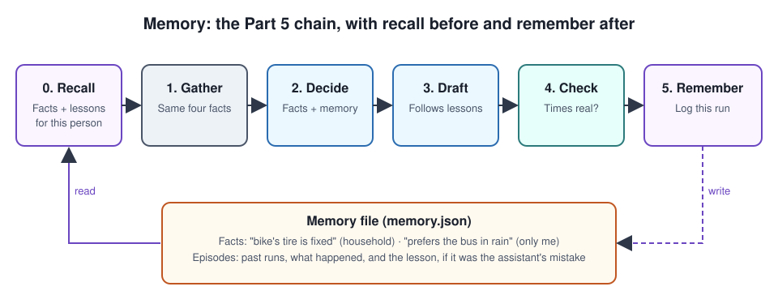

# Memory

**Remember what people told you, and what went wrong last time.**

[← All blueprints](../../README.md) · Builds on [Prompt chaining](../prompt-chaining/)

**On this page**

- [What is memory?](#what-is-memory)
- [The problem](#the-problem)
- [The idea](#the-idea)
- [Try it in one minute](#try-it-in-one-minute)
- [Try it with a real AI model](#try-it-with-a-real-ai-model)
- [The code, step by step](#the-code-step-by-step)
- [What this blueprint leaves out](#what-this-blueprint-leaves-out)
- [When to use it, and when not to](#when-to-use-it-and-when-not-to)
- [Common mistakes](#common-mistakes)

## What is memory?

A model remembers nothing between calls. Every call starts from zero. Anything an assistant seems to "remember" is text your code saved earlier and puts back into the prompt.

So memory is two small jobs around your existing code:

- **Recall**, before the work: read what you know about this person.
- **Remember**, after the work: write down what's worth keeping.

Think of a good doctor's notes. The doctor doesn't remember every patient. Before you come in, they read your file. After you leave, they add a line. The file does the remembering.

## The problem

Part 5's chain answers "Can I bike to the farmers market tomorrow morning?" the same way every time. That's its strength, and this week it was the problem.

- **Saturday:** the bike had a flat tire, so the chain said bus. But the reply said "great plan" and never said why, so I nearly took the flat bike.
- **Wednesday:** I fixed the tire and told the assistant. I also said I'd rather take the bus when it rains.
- **Friday:** I asked again. It had forgotten all of it. The bike check still said "flat tire", nothing kept what I'd said, and the reply made the same vague mistake.

A bigger model wouldn't fix this. The chain simply has nowhere to keep anything.

## The idea



Keep the chain. Add one step at each end:

```text
recall  ->  gather  ->  decide  ->  draft  ->  check  ->  remember
```

The memory file holds two kinds of things:

| Kind | What it is | Example |
| --- | --- | --- |
| **Facts** | What is true now | "The bike's tire is fixed." |
| **Episodes** | What happened on past runs | "The reply said 'great plan' and never said why. Lesson: start with the decision and the reason." |

Every memory also has a **scope**, which says who may see it:

| Scope | Who sees it | Example |
| --- | --- | --- |
| Household | Me and Sam, who shares the bike | "The bike's tire is fixed." |
| Only me | Just me | "Prefers the bus when it's raining." |

Our neighbour Ben uses the same app. He sees none of it.

## Try it in one minute

No AI model needed. Every step is plain code.

```bash
cd patterns/memory
python example.py
```

It plays the week: Saturday, Wednesday, Friday, then Sam asks. Afterwards, open `memory.json` to see every fact and episode that was saved.

## Try it with a real AI model

```bash
pip install -r requirements.txt
MODEL=openai:gpt-4.1 python agent.py
```

Set `MODEL` to any chat model that LangChain supports, and set your API key the usual way.

| Step | Who does it | Model calls |
| --- | --- | --- |
| 0. Recall | Code (a lookup) | 0 |
| 1. Gather | Code | 0 |
| 2. Decide | Model, with facts and memory | 1 |
| 3. Draft | Model, with past lessons | 1 |
| 4. Check | Code | 0 |
| 5. Remember | Code | 0 |

Answering still takes two calls, the same as Part 5. The one new cost comes when someone *tells* the assistant something: one model call to pick out the facts worth keeping.

## The code, step by step

We follow the week from `example.py`.

### The memory file

`memory_store.py` is a small class around one JSON file. It has four jobs:

```python
store.save_fact(topic, text, scope, source, date)   # remember a fact
store.facts_for(person)                              # recall facts this person may see
store.log_episode(goal, decision, reply, scope, date)
store.lessons_for(person)                            # recall lessons from past mistakes
```

A real app would use a database or a vector store. The jobs stay the same.

### Saturday: no memory yet

Recall finds nothing. The chain runs exactly like Part 5: flat tire, so the bus. The draft is the vague reply a real model wrote in Part 5:

> "Sounds like a great plan! Just remember to leave home at 09:00 to catch the 09:10 bus."

The check passes, because both times are right. Then `remember` logs the run. I say what went wrong, and that becomes a lesson on the episode:

```python
store.add_feedback(run_id, "...never said the bike was flat...",
                   cause="assistant_mistake",
                   lesson="Start with the decision and the reason. If it's the bus, name Bus 12.")
```

### Wednesday: I tell it two things

"Bike's fixed, by the way." becomes a household fact. "If it's raining, I'd rather take the bus." becomes a fact for me only.

The new bike fact **replaces** the old "tire is flat" fact, because they share a topic. The old one stays in the file, marked `replaced_by`, so you can see the history. Only current facts are recalled.

### Friday: the same question

```text
  0. recall   -> 2 facts, 1 lesson
  1. gather   -> 4 facts
  2. decide   -> bus, because your bike is fixed, but it's raining until 9
                 and you'd rather not cycle in the rain
  3. draft    -> Take Bus 12, not the bike: ... Leave home at 09:00 and catch the 09:10.
  4. check    -> OK
```

Two things changed the answer:

- **Newer beats older.** The bike check still says "flat tire", but it was last checked on 21 Nov. My fact is from 25 Nov, so decide trusts the fact.
- **The lesson reached the draft.** The reply now starts with the decision and the reason, and names Bus 12.

### Sam asks too

Sam sees the household fact (bike fixed) and the household lesson, but not my rain preference. So for Sam the answer is the bike. Same chain, same facts, a different person, a different answer.

## What this blueprint leaves out

To keep it small, this blueprint covers long-term memory: facts, episodes and scopes. Real assistants usually also need:

- **Short-term memory.** In a long chat, summarise old turns and keep only recent ones, so the prompt doesn't fill with old tool output.
- **Checkpoints.** Save the chain's state after each step, so it can pause for a "yes" or survive a crash.
- **Clean-up.** Over months, merge duplicates and expire stale facts.

## When to use it, and when not to

**Use memory when:**
- People come back and expect to be known.
- The same kind of task repeats, and so do its mistakes.

**Skip it when:**
- Every question stands alone.
- A live tool already knows the truth. Look up the weather; don't remember it.
- You can't yet control who sees what. Add scopes first.

## Common mistakes

- **Saving everything.** Keep decisions and preferences, not forecasts and timetables.
- **No way to replace a fact.** "Flat" must be able to become "fixed".
- **Trusting old memory over a fresh check**, or the other way round. Compare dates.
- **Learning from the world's bad days.** Bus 12 once didn't come because of roadworks. That's `outside_world`, not a lesson. Only the assistant's own mistakes become lessons.
- **Adding scopes later.** By then, everyone's memories are already mixed.
