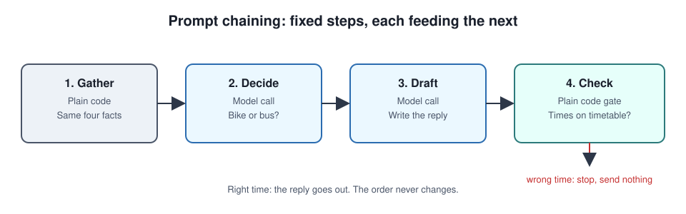

# Prompt chaining

**Break a big question into small steps, and run them in the same order every time.**

[← All blueprints](../../README.md) · Builds on [Routing](../routing/) and [ReAct](../react/)

**On this page**

- [What is prompt chaining?](#what-is-prompt-chaining)
- [The problem](#the-problem)
- [The idea](#the-idea)
- [Try it in one minute](#try-it-in-one-minute)
- [Try it with a real AI model](#try-it-with-a-real-ai-model)
- [The code, step by step](#the-code-step-by-step)
- [When to use it, and when not to](#when-to-use-it-and-when-not-to)
- [Common mistakes](#common-mistakes)

## What is prompt chaining?

Prompt chaining is a recipe. You write the steps down in order, and each step hands its result to the next one.

Think of a cake. First you measure, then you mix, then you bake, then you check it is cooked. You never bake before you mix. Each step is easy on its own, and the order is what makes the cake.

A chain does the same thing with model calls. Each step does one small job, and its output becomes the next step's input.

Anthropic describes it in [Building Effective Agents](https://www.anthropic.com/engineering/building-effective-agents).

## The problem

The ReAct agent, from Part 2, decides its own steps. It asked about the weather, the calendar, the bike and the bus, in an order it picked itself. For the market question, that worked. But the order can change from run to run, and sometimes the agent stops early, as the routing article showed.

Sometimes you already know the steps. "Plan my morning" always needs the same facts, and always ends with a check before the reply goes out. You do not need the model to pick the order.

## The idea



1. **Gather**: collect the facts. Plain code, no model.
2. **Decide**: turn the facts into one choice, for example bike or bus.
3. **Draft**: write the reply, using only that choice.
4. **Check**: a gate. If the reply has a wrong time, the chain stops and sends nothing.

Two rules make a chain safe:

- Every step has one job. A small job is easy to test.
- Put a check at the end. A chain can only be as right as its last step lets through.

## Try it in one minute

No AI model needed. Each step is plain code.

```bash
cd patterns/prompt-chaining
python example.py
```

You will see each step's output, the check's verdict, and a second run with a deliberate mistake, where the check stops the chain.

## Try it with a real AI model

```bash
MODEL=openai:gpt-4.1 python agent.py
```

Set `MODEL` to any chat model that LangChain supports, and set your API key the usual way. You need the packages in `requirements.txt`.

The real version changes two steps to model calls:

| Step | Who does it | Model calls |
| --- | --- | --- |
| 1. Gather | Code | 0 |
| 2. Decide | Model, one word | 1 |
| 3. Draft | Model, one reply | 1 |
| 4. Check | Code | 0 |

Two calls, every time. The ReAct agent took about five for the same question.

## The code, step by step

Let's follow one question through the chain. The question is:

> "Can I bike to the farmers market tomorrow morning?"

Think of it as a relay race. Four runners, one baton. Each runner hands the baton to the next one, and nobody skips a turn.

In the code, the whole relay is one line:

```python
return (
    RunnableLambda(gather)
    | RunnableLambda(decide_step)
    | RunnableLambda(draft_step)
    | RunnableLambda(check)
)
```

The `|` symbol means "hand the result to the next runner".

### Runner 1: gather

**What it does:** it looks up the facts. The weather, the calendar, the bike and the bus.

**Who does the work:** plain code. No model is involved.

**What it hands on:** a list of four facts, always in the same order.

```python
facts = {"weather": ..., "calendar": ..., "bike": ..., "bus": ...}
```

Gather never makes a choice. It only collects.

### Runner 2: decide

**What it does:** it reads the facts and makes one choice, bike or bus.

**Who does the work:** the model. We give it the facts and a strict rule: answer with one word.

```python
decide = DECIDE_PROMPT | model | StrOutputParser()
```

If the model says "bike", we go on. If it says anything else, such as "walk", the relay stops right here with an error. That's on purpose: a wrong answer should not reach the next runner.

The bus time is still found by code. A model is not good at clock arithmetic, so we don't ask it to do that.

### Runner 3: draft

**What it does:** it writes the reply for the person.

**Who does the work:** the model again, with its own prompt.

It is told the only times it may use, like "Leave home at 09:00. Take the 09:10 bus." It sees only the choice and those times, not the whole question. Keeping its view small makes it less likely to invent something.

### Runner 4: check

**What it does:** it reads the reply and looks for every time in it, such as 09:10.

**Who does the work:** plain code. This is the final gate.

If every time is on the timetable, the reply goes out. If one is wrong, the check returns no reply and explains why:

```python
if wrong:
    return {"reply": None, "verdict": "STOP: ... 09:30"}
```

This runner is what makes the chain safe to run without someone watching it.

### The finished run

Here is what the printout looks like for the good question:

1. **gather:** 4 facts.
2. **decide:** bus.
3. **draft:** "Your bike has a flat tire, so take Bus 12. Leave home at 09:00 and catch the 09:10 bus."
4. **check:** OK, every time is on the timetable.

Two of the four runners used the model, so the chain made two model calls. A small counter, a LangChain callback, counts them for you.

## When to use it, and when not to

**Use a chain when:**
- You know the steps in advance, and they always run in the same order.
- Each step's output is clear enough to pass on.
- You want a predictable number of model calls, and easy testing.

**Use the ReAct agent instead when:**
- The steps depend on what the agent finds. Each result decides the next tool.

**Use routing first when:**
- Different kinds of question need different chains. Pick the chain with a router.

## Common mistakes

- **Chaining too much into one step.** If a step does three jobs, you cannot test any of them alone. Split it.
- **No check at the end.** The chain sends whatever the last step wrote. Always check the output before it leaves.
- **Asking the model to do arithmetic.** Work out times, totals and counts in code. Use the model for words.
- **Passing everything to every step.** Give each step only what it needs. Less text means fewer mistakes and fewer tokens.
