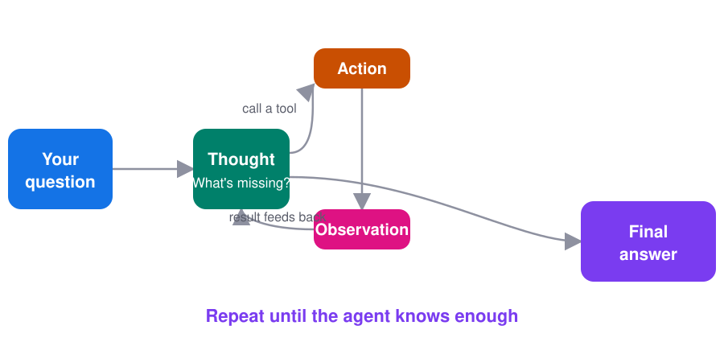

# ReAct

**Let the model think, act, look, and repeat - until it knows enough to answer.**

[← All blueprints](../../README.md)

**On this page**

- [What is ReAct?](#what-is-react)
- [The problem](#the-problem)
- [The idea](#the-idea)
- [Why not just ask once](#why-not-just-ask-once)
- [The three parts](#the-three-parts)
- [Try it in one minute](#try-it-in-one-minute)
- [Try it with a real AI model](#try-it-with-a-real-ai-model)
- [The code, step by step](#the-code-step-by-step)
- [A turn can fail](#a-turn-can-fail)
- [Always set a turn limit](#always-set-a-turn-limit)
- [ReAct or fan-out/fan-in?](#react-or-fan-outfan-in)
- [Try it on real data](#try-it-on-real-data)
- [When to use it, and when not to](#when-to-use-it-and-when-not-to)
- [Common mistakes](#common-mistakes)

## What is ReAct?

ReAct - short for **Re**asoning + **Act**ing - is the foundational pattern for building autonomous AI agents. It was introduced in a 2022 research paper by Yao et al. (*"ReAct: Synergizing Reasoning and Acting in Language Models"*) and it underpins almost every agent framework in use today.

The insight is simple but powerful. Before ReAct, language models were mostly used in two separate ways:

- **Chain-of-Thought prompting:** the model writes out its reasoning step by step, then answers. Great for logic, but it reasons in a vacuum - it can only use knowledge frozen into its weights, so it hallucinates facts.
- **Action-taking systems:** the model calls an API or tool and reports the result. Great for fresh data, but it acts without thinking - one blind step, no plan, no recovery when things go wrong.

ReAct combines them. The model interleaves *reasoning traces* (thoughts) with *actions* (tool calls) in a single loop: it thinks about what it needs, acts to get it, reads what came back, and thinks again. Reasoning guides the actions; observations ground the reasoning.

This is why ReAct matters: it's the difference between an LLM that *describes* a task and an agent that *does* the task. If you've used an AI coding assistant that searches your code, reads files, and iterates on errors - that's ReAct. When Devin, Claude Code, or a LangChain agent "works through" a problem step by step, it's running some version of this loop.

## The problem

You ask an AI assistant:

> "Can I bike to the farmers market tomorrow morning?"

A model that answers in one shot has to guess. It doesn't know tomorrow's weather, whether you're free, or if your bike even works. So it says something pleasant and useless:

> "Biking is a great way to get to the market!"

The real answer is assembled from facts the model doesn't have yet. And here's the hard part: you can't list them in advance. If it rains until 9am, the next question is "can I go later?" If the bike has a flat tire, the next question is "is there a bus?" Each answer decides what to check next.

This is exactly the shape ReAct was made for. It's the pattern introduced by Yao et al. in 2022, and it's the loop underneath almost every agent you use today.

## The idea



Instead of answering in one shot, the agent alternates between reasoning and acting:

1. **Thought** - the model looks at what it knows and asks: what am I still missing?
2. **Action** - it picks one tool and calls it (weather, calendar, search, calculator...).
3. **Observation** - the tool runs, and the result is added to the model's memory.

Then it loops. Each turn, the thought is informed by everything observed so far, so the agent can follow a trail it couldn't have planned upfront. When a thought concludes "I know enough," the loop exits and the agent answers.

## Why not just ask once

Three reasons:

- **Fresh facts.** The model's knowledge is frozen at training time. Tools give it today's weather, your calendar, live data.
- **Grounding.** Every claim can be traced to a tool result instead of a guess.
- **Adaptivity.** The plan emerges as facts arrive. Rain changes the route; a flat tire changes the vehicle.

## The three parts

| Part | Who does it | In the code |
|---|---|---|
| Thought | The model reasons about what's missing | `model.invoke(messages)` or the `think()` stand-in |
| Action | The model names a tool and its input | `response.tool_calls` |
| Observation | Your code runs the tool, returns the result | `TOOLS[name](args)` → `ToolMessage` |

## Try it in one minute

No API key needed. A small rule-based "thinker" plays the role of the LLM so you can watch the loop:

```bash
pip install -r requirements.txt
python example.py
```

```
You: Can I bike to the farmers market tomorrow morning?

Thought 1:     First I need to know if it will even be nice enough to bike.
Action 1:      check_weather('tomorrow morning')
Observation 1: Light rain until 9am, then sunny and 18C.

Thought 2:     There is rain until 9am. The market opens at 8 - can I go later?
Action 2:      check_calendar('tomorrow')
Observation 2: You are free until noon.

Thought 3:     Weather and timing work. Now, is the bike itself ready?
Action 3:      check_bike()
Observation 3: Your bike has a flat tire.

Thought 4:     The bike is out. Is there a backup way to get there?
Action 4:      check_bus('farmers market')
Observation 4: Bus 12 runs every 15 minutes to Market Square.

Answer: Yes, you can go - but take Bus 12. Your bike has a flat tire, and
the rain stops at 9am anyway, which fits your free morning.
```

Notice that nobody wrote that plan. Each step was chosen because of what the previous step found.

## Try it with a real AI model

`agent.py` is the same loop, but the model writes the thoughts and picks the tools:

```bash
MODEL=openai:gpt-5 python agent.py
MODEL=anthropic:claude-opus-4-5 python agent.py "Can I bike to the market on Sunday?"
```

Each provider needs its partner package (`langchain-openai`, `langchain-anthropic`, ...) and your key exported (`OPENAI_API_KEY`, ...). If your OpenAI org isn't verified for `gpt-5` yet, `MODEL=openai:gpt-4o-mini` works fine.

Any provider works - see [Use any AI model](../fan-out-fan-in/README.md#use-any-ai-model) in the fan-out/fan-in blueprint.

## The code, step by step

The whole pattern is one `for` loop:

```python
for turn in range(1, MAX_TURNS + 1):
    response = model.invoke(messages)          # Thought
    messages.append(response)
    if not response.tool_calls:                # "I know enough"
        return response.content
    call = response.tool_calls[0]              # Action
    result = TOOLS[call["name"]](call["args"]) # run the tool
    messages.append(ToolMessage(result, ...))  # Observation
```

Three details carry the weight:

- **Memory is just a list.** Every thought, action and observation is appended to `messages`. The model sees the whole trail each turn - that's how it avoids asking the same question twice.
- **One tool per turn.** Forcing a single action keeps the thought→action→observation rhythm visible, and makes the trace easy to debug.
- **The exit is a thought, not a flag.** The loop ends when the model stops asking for tools. Your code only supplies facts; the model decides when it's done.

## A turn can fail

Tools are real code - they time out, return errors, hit dead APIs. Don't crash the loop. Return the failure as the observation:

```python
try:
    result = TOOLS[call["name"]].invoke(call["args"])
except Exception as exc:
    result = f"This tool failed: {type(exc).__name__}"
```

The model reads it and adapts - retries, tries another tool, or tells you what it couldn't confirm.

## Always set a turn limit

An agent that never concludes will loop forever and spend money forever. `MAX_TURNS = 6` is enough for this example; pick a limit that fits your task, and return a graceful fallback when you hit it.

## ReAct or fan-out/fan-in?

| | ReAct | Fan-out/fan-in |
|---|---|---|
| Steps known in advance? | No - each result decides the next step | Yes - you can list the systems upfront |
| Tool calls | One at a time, sequentially | All at once, in parallel |
| Best for | Trails: search → read → refine → decide | Fixed checks across known systems |

They combine well: a ReAct agent can fan out inside one action when several independent lookups are due at once.

## Try it on real data

`try_it.py` swaps the pretend weather tool for the free [Open-Meteo](https://open-meteo.com) API - no key needed. Ask about any city:

```bash
python try_it.py Tokyo
MODEL=openai:gpt-5 python try_it.py "San Francisco"
```

The agent now reasons over a real forecast for tomorrow morning. The calendar, bike and bus tools are still pretend - replace them with your own apps to make it yours.

## When to use it, and when not to

**Use ReAct when**

- the answer depends on facts the model doesn't have,
- you can't predict which facts - each result changes what to check next,
- or you want a traceable trail of why the agent did what it did.

**Don't use it when**

- one lookup suffices - a single tool call is not a loop,
- the steps are fixed - use a [workflow](../fan-out-fan-in/) and skip the model's turn-by-turn cost,
- or latency matters - five sequential model calls are slower than one.

## Common mistakes

- **No turn limit.** The first thing to write is `MAX_TURNS`.
- **Vague tool descriptions.** The model picks tools by reading their docstrings. "Check the weather forecast for a time like 'tomorrow morning'" beats "weather".
- **Hiding the trail.** Print each thought/action/observation while developing. Debugging a ReAct agent without its trace is guesswork.
- **Letting the model mark its own homework.** If a claim matters, have it come from a tool, not from the model's memory.
