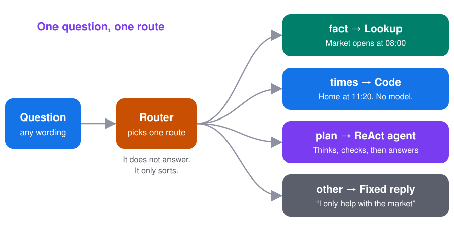
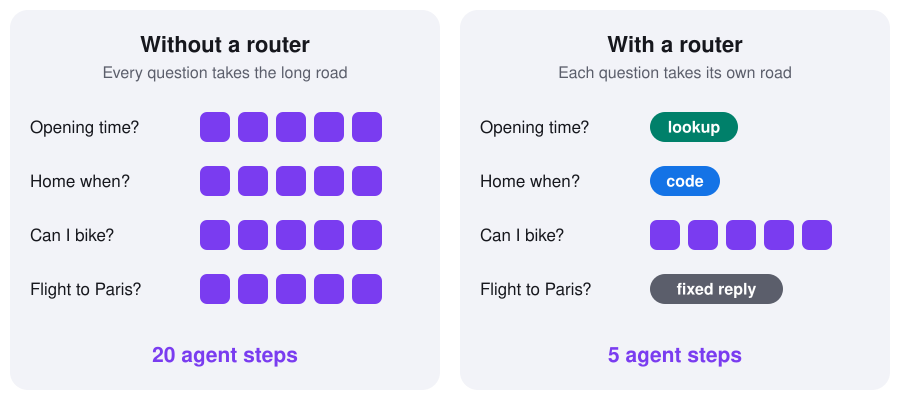
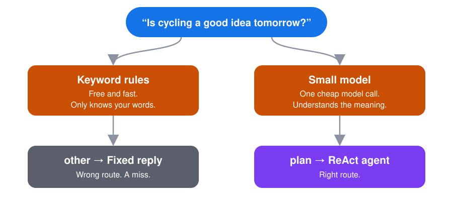

# Routing

**Look at each question first, then send it to the right place.**

[← All blueprints](../../README.md) · Builds on [ReAct](../react/) and [Evaluator-optimizer](../evaluatoroptimizer/)

**On this page**

- [What is routing?](#what-is-routing)
- [The problem](#the-problem)
- [The idea](#the-idea)
- [The four routes](#the-four-routes)
- [Try it in one minute](#try-it-in-one-minute)
- [Two kinds of router](#two-kinds-of-router)
- [Try it with a real AI model](#try-it-with-a-real-ai-model)
- [The code, step by step](#the-code-step-by-step)
- [When to use it, and when not to](#when-to-use-it-and-when-not-to)
- [Common mistakes](#common-mistakes)

## What is routing?

Routing is one small step at the front of your app. It reads the question, decides what kind of question it is, and sends it to the one place that handles that kind.

Think of the front desk at a hospital. The person there doesn't treat you. They ask what's wrong and send you to the right room: a plaster for a small cut, an X-ray for a fall, the emergency doctor for chest pain. Nobody sends a small cut to the surgeon.

A **router** is that front desk. Each room is a **route**.

Anthropic describes it in [Building Effective Agents](https://www.anthropic.com/engineering/building-effective-agents).

## The problem

In the last two examples, the agent answered one question:

> "Can I bike to the farmers market tomorrow morning?"

It checked the weather, the calendar, the bike and the bus. That's four tools and five thinking steps. For that question, the work is worth it.

But people ask small questions too:

> "What time does the market open?"

If every question goes to the agent, this one also gets the weather, the calendar, the bike and the bus. Five steps, to say "08:00".

It's like asking a friend "what time is it?" and getting a full plan for your day. The answer is in there somewhere, but it took too long and cost too much.

Small questions should get small answers.

## The idea



1. The **router** reads the question and picks one route from a short, fixed list.
2. Only that route does the work.
3. If the router is not sure, the question goes to a safe route called `other`.

The router never answers the question. It only sorts.

## The four routes

The same market morning, four kinds of question:

| Question | Route | Who does the work | Cost |
|---|---|---|---|
| "What time does the market open?" | `fact` | A lookup | Almost nothing |
| "What time will I get home if I take the bus?" | `times` | Plain code | No model at all |
| "Can I bike to the farmers market tomorrow morning?" | `plan` | The ReAct agent | Five steps |
| "Can you book me a flight to Paris?" | `other` | A fixed reply | Nothing |

Two of these are worth a closer look.

**`times` goes to code.** In the evaluator-optimizer example, a model got the bus times wrong again and again. Adding minutes is a job for code, not for a model. So this route has no model in it.

**`other` is the safety net.** The assistant only knows about the market trip. For anything else it says so. It doesn't try, and it doesn't make something up.



## Try it in one minute

No API key needed. The router here is a few keyword rules:

```bash
python example.py
```

```
You: What time does the market open?
Router: -> fact
Answer: The market opens at 08:00 and closes at 13:00.
Work:   1 lookup

You: What time will I get home if I take the bus?
Router: -> times
Answer: Leave at 09:00, take the 09:10 bus, shop 09:40-10:40, take the 10:50 bus back. You are home at 11:20.
Work:   code, no model

You: Can I bike to the farmers market tomorrow morning?
Router: -> plan
    Thought 1: Will it be nice enough to bike?
    Tool 1:    check_weather() -> Light rain until 9am, then sunny and 18C.
    ...
    Thought 5: I know enough to answer.
Answer: Your bike has a flat tire. The rain stops at 9 AM, so take Bus 12 after 9.
Work:   5 agent steps

You: Can you book me a flight to Paris?
Router: -> other
Answer: Sorry, I can only help with your trip to the market.
Work:   nothing

=== What routing saved ===
Without a router, all 4 questions go to the agent: 4 x 5 = 20 agent steps.
With the router: 5 agent steps. The other questions never needed the agent.
```

Only one question in four needed the agent. The other three were answered faster and cheaper, and the `times` answer is always right because code did the maths.

## Two kinds of router

The example ends with one more question:

```
=== Where keyword rules fall short ===
You: Is cycling a good idea tomorrow?
Router: -> other
Answer: Sorry, I can only help with your trip to the market.
```

That's wrong. It is a planning question. But it doesn't say "can I" or "should I", so the rules didn't recognise it.



There are two common ways to build a router:

| | Keyword rules | A small model |
|---|---|---|
| Cost | Free | One cheap model call per question |
| Speed | Instant | A short wait |
| Understands new wording | No | Yes |
| Good for | Menus, buttons, fixed commands | Free text typed by people |

Start with rules if your questions come in a few fixed forms. Use a model when people can type anything.

## Try it with a real AI model

`agent.py` is the same four routes, but the router is one small model call:

```bash
pip install -r requirements.txt
MODEL=openai:gpt-4.1 python agent.py
```

Each provider needs its partner package (`langchain-openai`, `langchain-anthropic`, ...) and your key exported (`OPENAI_API_KEY`, ...).

Routing is also a good place to save money. Sorting a question is easy work, so a small model can do it. Keep the large model for the `plan` route:

```bash
MODEL=openai:gpt-4.1 SMALL_MODEL=openai:gpt-4o-mini python agent.py
```

After each question it prints how many model calls were made, for example `Model calls: 1 (1 for the router, 0 for the route)`.

You can ask your own questions too:

```bash
MODEL=openai:gpt-4.1 python agent.py "Is the market open on Sunday?"
```

Real models don't always agree with you about which route is right. Try a few questions and read the `Router:` line. That one line tells you most of what you need to know.

In one real run, the router sent all five demo questions to the right route, including "Is cycling a good idea tomorrow?", which the keyword rules miss. The five questions took ten model calls in total, and three of them never reached the agent.

The same run showed what routing does not fix. On the `plan` route the agent checked only the bike, saw the flat tire, and asked "Would you like to explore other ways to get there?" It never looked at the bus. The router picked the right route. How well that route works is a separate question, and it's the reason the [evaluator-optimizer](../evaluatoroptimizer/) exists.

## The code, step by step

### The router

```python
ROUTES = ["fact", "times", "plan", "other"]

def route(small_model, question: str) -> str:
    reply = ask_model(small_model, [SystemMessage(ROUTER_INSTRUCTIONS), HumanMessage(question)])
    word = StrOutputParser().invoke(reply).strip().strip(".'\"`").lower()
    return word if word in ROUTES else "other"
```

The router's instructions list the four routes, with one plain line about each, and ask for **one word** back.

The last line matters most. If the model replies with anything that is not on the list, the question goes to `other`. The router never invents a new route, and an unreadable reply never reaches the agent.

### The routes

```python
HANDLERS = {
    "fact": answer_fact,     # a small model reads a short fact sheet
    "times": answer_times,   # plain code, no model
    "plan": answer_plan,     # the ReAct agent from Part 2
    "other": answer_other,   # a fixed reply
}
```

Each route is just a function. `answer_plan` is the ReAct loop, copied unchanged. In a real app this route could be the full evaluator-optimizer from Part 3, with the reviewer.

### Putting it together

```python
name = route(small_model, question)     # Step 1: pick a route
answer = HANDLERS[name](...)            # Step 2: only that route works
```

That is the whole pattern. Two lines.

### The offline version

`example.py` has the same four routes and the same two lines. Only the router is different:

```python
RULES = [
    ("fact", ["open", "close", "which bus"]),
    ("times", ["what time will", "when will", "how long"]),
    ("plan", ["can i", "should i"]),
]
```

It looks for these words in the question, and the first match wins. If nothing matches, it returns `other`.

## When to use it, and when not to

**Use routing when**

- your questions fall into a few clear kinds,
- the kinds need very different amounts of work,
- some questions can be answered by code or a lookup, with no model at all.

**Don't use it when**

- every question needs the same work. A router would only add a step,
- you can't say clearly how the kinds differ. If you can't sort them, the router can't either,
- there are dozens of routes. The router will start to mix them up. Group them first.

## Common mistakes

- **No safety net.** Always have an `other` route. Without it, a strange question goes somewhere it doesn't belong.
- **A router that also answers.** Keep it to one job: pick a route. A router that tries to help gives slow, unchecked answers.
- **Routes that overlap.** If two routes could both take a question, the router will flip between them. Write one plain line about each route, and make the lines different.
- **Sending maths to a model.** Times, totals and dates go to code.
- **Never checking the router.** A wrong route gives a wrong answer that sounds sure of itself. Keep a short list of test questions with the route you expect, and run it whenever you change the router.
- **Hiding the route.** Print or log which route was picked. When an answer is wrong, it's the first thing you'll want to know.
